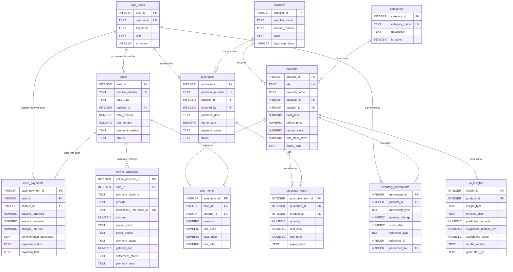
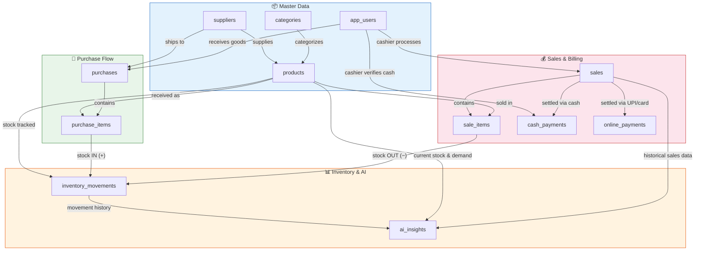

# AI Kirana Store — ER Diagram

## Entity-Relationship Diagram

---

## Table Relationships Explained

### One-to-Many Relationships

| Parent Table | Child Table | FK Column | Relationship | ON DELETE |
|---|---|---|---|---|
| `categories` | `products` | `category_id` | One category has many products | RESTRICT |
| `suppliers` | `products` | `supplier_id` | One supplier supplies many products | SET NULL |
| `app_users` | `sales` | `cashier_id` | One cashier processes many sales | RESTRICT |
| `sales` | `sale_items` | `sale_id` | One sale has many line items | CASCADE |
| `products` | `sale_items` | `product_id` | One product appears in many sale items | RESTRICT |
| `sales` | `cash_payments` | `sale_id` | One sale can have cash payments | CASCADE |
| `app_users` | `cash_payments` | `cashier_id` | One cashier verifies and handles cash | RESTRICT |
| `sales` | `online_payments` | `sale_id` | One sale can have online payments | CASCADE |
| `suppliers` | `purchases` | `supplier_id` | One supplier has many purchase orders | RESTRICT |
| `app_users` | `purchases` | `received_by` | One user receives many purchases | RESTRICT |
| `purchases` | `purchase_items` | `purchase_id` | One purchase has many line items | CASCADE |
| `products` | `purchase_items` | `product_id` | One product appears in many purchase items | RESTRICT |
| `products` | `inventory_movements` | `product_id` | One product has many stock movements | RESTRICT |
| `app_users` | `inventory_movements` | `performed_by` | One user performs many stock changes | SET NULL |
| `products` | `ai_insights` | `product_id` | One product has many AI forecasts | CASCADE |

---

## Data Flow Diagram

---

## Quick Reference Table (12 Tables)

| # | Table | Primary Key | Foreign Keys | Purpose |
|---|---|---|---|---|
| 1 | `app_users` | `user_id` | — | Staff and administrator accounts |
| 2 | `categories` | `category_id` | — | Product categories (Dairy, Grains, etc.) |
| 3 | `suppliers` | `supplier_id` | — | Vendor/supplier master data |
| 4 | `products` | `product_id` | `category_id`, `supplier_id` | Product catalog with prices, stock, and expiry |
| 5 | `sales` | `sale_id` | `cashier_id` | Customer bills/invoices header |
| 6 | `cash_payments` | `cash_payment_id` | `sale_id`, `cashier_id` | Cash payment details, tendered, change & denominations |
| 7 | `online_payments` | `online_payment_id` | `sale_id` | Digital payments (UPI, QR, Card POS, provider, UTR) |
| 8 | `sale_items` | `sale_item_id` | `sale_id`, `product_id` | Individual products sold in each bill |
| 9 | `purchases` | `purchase_id` | `supplier_id`, `received_by` | Supplier purchase orders header |
| 10 | `purchase_items` | `purchase_item_id` | `purchase_id`, `product_id` | Line items received in each purchase order |
| 11 | `inventory_movements` | `movement_id` | `product_id`, `performed_by` | Immutable audit trail of every stock change |
| 12 | `ai_insights` | `insight_id` | `product_id` | AI/SQL demand forecasts and restocking recommendations |

---

## Key Design Decisions

1. **SQLite 3 Type Affinity**: SQLite is serverless and lightweight with zero external server dependencies, making it optimal for local Kirana AI edge deployments, laptops, Raspberry Pi, and mobile setups. Currency and quantities use `NUMERIC` with explicit `CHECK` constraints (e.g. `>= 0`).
2. **Dedicated Payment Schemas**: Two specialized tables (`cash_payments` and `online_payments`) provide clean separation of concerns. Cash tracks drawer balance, amount tendered, and return change; Online tracks provider, UTR reference number, settlement status, and gateway fees.
3. **Snapshot pricing**: `sale_items.unit_price` and `sale_items.cost_price` capture the price **at the time of sale**.
4. **Soft deletes**: `is_active` integer flags (`1`/`0`) are used instead of deleting records.
5. **Unique constraints**: `sku`, `invoice_number`, `purchase_number`, and `transaction_reference_id` are enforced UNIQUE to prevent duplicates.
6. **ON DELETE behavior**:
   - **CASCADE**: Deleting a sale cascades to its sale items, cash payments, and online payments.
   - **RESTRICT**: Cannot delete categories, suppliers, or products that have historical references.
   - **SET NULL**: Deleting an optional reference (like performed_by user on an inventory adjustment) sets the foreign key to NULL.
