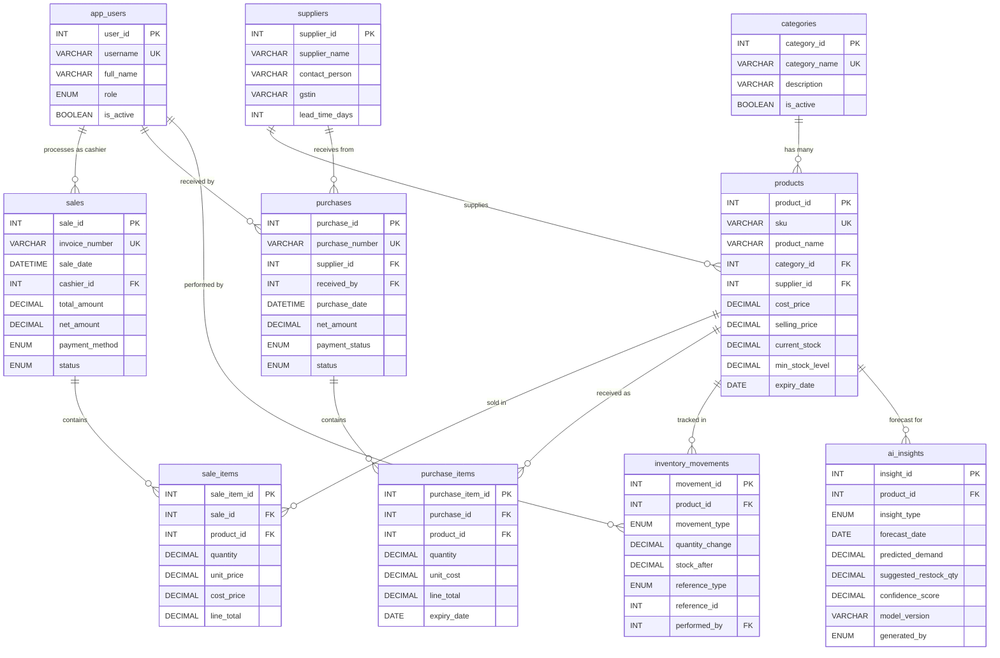
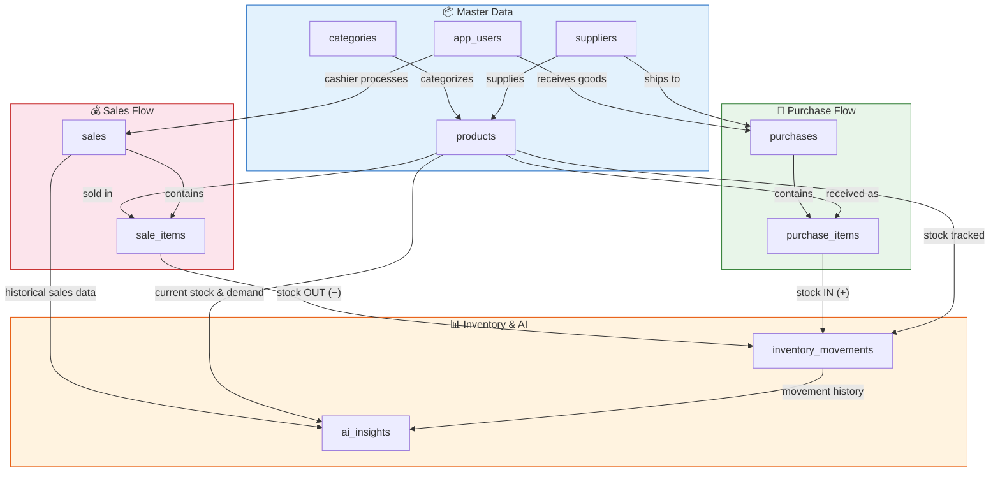

# AI Kirana Store — ER Diagram

## Entity-Relationship Diagram

---

## Table Relationships Explained

### One-to-Many Relationships

| Parent Table | Child Table | FK Column | Relationship | ON DELETE |
|---|---|---|---|---|
| `categories` | `products` | `category_id` | One category has many products | RESTRICT |
| `suppliers` | `products` | `supplier_id` | One supplier supplies many products | SET NULL |
| `app_users` | `sales` | `cashier_id` | One cashier processes many sales | RESTRICT |
| `sales` | `sale_items` | `sale_id` | One sale has many line items | CASCADE |
| `products` | `sale_items` | `product_id` | One product appears in many sale items | RESTRICT |
| `suppliers` | `purchases` | `supplier_id` | One supplier has many purchase orders | RESTRICT |
| `app_users` | `purchases` | `received_by` | One user receives many purchases | RESTRICT |
| `purchases` | `purchase_items` | `purchase_id` | One purchase has many line items | CASCADE |
| `products` | `purchase_items` | `product_id` | One product appears in many purchase items | RESTRICT |
| `products` | `inventory_movements` | `product_id` | One product has many stock movements | RESTRICT |
| `app_users` | `inventory_movements` | `performed_by` | One user performs many stock changes | SET NULL |
| `products` | `ai_insights` | `product_id` | One product has many AI forecasts | CASCADE |

### What Each Relationship Means (Simple English)

1. **categories → products**: Every product belongs to exactly one category (like "Dairy" or "Grains"). A category can have many products. You cannot delete a category that has products (RESTRICT).

2. **suppliers → products**: A supplier can supply many products. If a supplier is deleted, the product's `supplier_id` becomes NULL (SET NULL) — the product still exists but has no supplier.

3. **app_users → sales**: Every sale is processed by one cashier (an app_user). One cashier can handle many sales. You cannot delete a user who has processed sales.

4. **sales → sale_items**: One bill (sale) contains one or more products (sale_items). If a sale is deleted, all its line items are also deleted (CASCADE).

5. **products → sale_items**: A product can appear on many different bills. You cannot delete a product that has been sold (RESTRICT) — this preserves sales history.

6. **suppliers → purchases**: Purchase orders are placed with suppliers. One supplier can have many purchase orders.

7. **purchases → purchase_items**: One purchase order contains one or more product line items. Deleting a purchase cascades to its items.

8. **products → inventory_movements**: Every stock change (sale, purchase, adjustment, damage) is recorded as a movement against a product.

9. **products → ai_insights**: AI forecasts and suggestions are linked to specific products.

---

## Data Flow Diagram

---

## Quick Reference Table

| # | Table | Primary Key | Foreign Keys | Purpose |
|---|---|---|---|---|
| 1 | `app_users` | `user_id` | — | Staff and admin accounts |
| 2 | `categories` | `category_id` | — | Product categories (Dairy, Grains, etc.) |
| 3 | `suppliers` | `supplier_id` | — | Vendor/supplier master data |
| 4 | `products` | `product_id` | `category_id`, `supplier_id` | Product catalog with prices and stock |
| 5 | `sales` | `sale_id` | `cashier_id` | Customer bills/invoices |
| 6 | `sale_items` | `sale_item_id` | `sale_id`, `product_id` | Individual products in each bill |
| 7 | `purchases` | `purchase_id` | `supplier_id`, `received_by` | Supplier purchase orders |
| 8 | `purchase_items` | `purchase_item_id` | `purchase_id`, `product_id` | Products received in each purchase |
| 9 | `inventory_movements` | `movement_id` | `product_id`, `performed_by` | Audit trail of every stock change |
| 10 | `ai_insights` | `insight_id` | `product_id` | AI/SQL demand forecasts and suggestions |

---

## Key Design Decisions

1. **DECIMAL for money**: All prices and amounts use `DECIMAL(10,2)` or `DECIMAL(12,2)` to avoid floating-point rounding errors. Never use `FLOAT` or `DOUBLE` for money.

2. **Snapshot pricing**: `sale_items.unit_price` and `sale_items.cost_price` capture the price **at the time of sale**. If the product price changes later, historical sales still show the original price.

3. **Soft deletes**: `is_active` flags are used instead of deleting records, preserving historical data.

4. **Unique constraints**: `sku`, `invoice_number`, and `purchase_number` are UNIQUE to prevent duplicates.

5. **ON DELETE behavior**:
   - **CASCADE**: Deleting a sale removes its items (they have no meaning without the sale)
   - **RESTRICT**: Cannot delete a product that has been sold (preserves history)
   - **SET NULL**: Deleting a supplier sets the product's `supplier_id` to NULL (product still exists)
